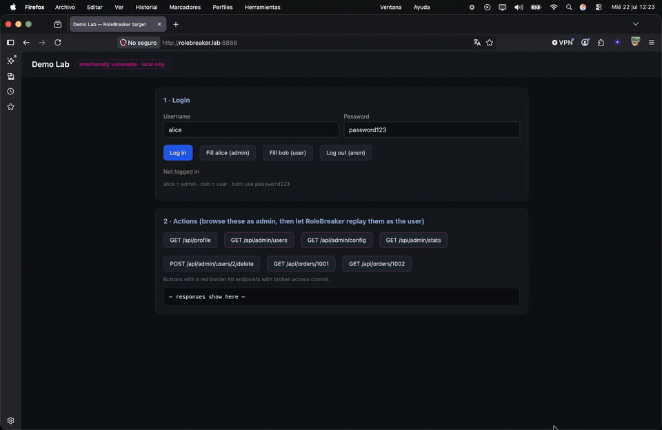
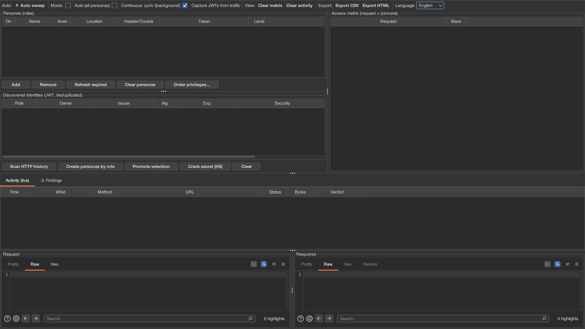
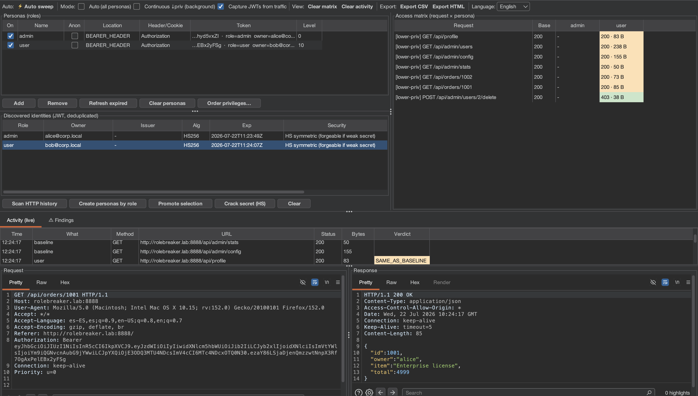

# RoleBreaker — Burp Suite Extension

A Burp Suite extension for **broken access control** and **privilege escalation** testing, driven by JWTs and multiple roles. Think of it as *Authorize* but designed around a per-role **access matrix** (endpoint × persona) with automatic token discovery, JWT security analysis, and a curated Findings view.

> **Feature requests and bug reports are welcome — open a [GitHub Issue](../../issues).**

---

## Demo

A full run against a small two-role JWT API: log in as both roles, one click on
**Auto sweep**, and RoleBreaker replays every request as the lower-privilege role and ranks
the broken-access findings.



| Starting state | Results |
|---|---|
|  |  |

In the matrix, the `user` column is amber/red on the endpoints that leak (vertical privesc +
IDOR), while the one correctly-enforced endpoint (`POST …/delete`) stays **green (403)**.

---

## Features at a glance

| Feature | What it does |
|---------|-------------|
| **Identity auto-discovery** | Scans proxy history + live traffic for JWTs and cookie sessions; no pasting |
| **Persona auto-creation** | One persona per JWT role; captured cookie sessions can be promoted in one click |
| **Cookie-based roles** | Full cookie bundles (session + CSRF), replay + lower-privilege matching |
| **⚡ Auto sweep** | One click: scan, rank, test recent requests with lower roles + anonymous, safely by default |
| **Continuous lower-priv mode** | Browse as admin — every new request is background-tested as lower roles |
| **Access matrix** | Endpoint × persona, colour-coded verdict |
| **Findings view** | Ranked, filterable by text/severity; export CSV/JSON, copy as cURL, send to Repeater |
| **JWT attacks** | `alg:none`, signature strip, role escalation — live verdict |
| **HMAC weak-secret cracker** | Offline HS256/384/512 against a built-in list or your wordlist |
| **IDOR / param tampering** | Numeric + UUID ids, cross-persona replay |
| **Token auto-refresh** | Swaps token from traffic (same `sub`) or re-logs in via a saved request |
| **Export** | CSV / HTML matrix with verdict colours |
| **Bilingual UI** | Loads in English by default; switch to Spanish from the toolbar (remembered across restarts) |

---

## How it works

For every request the extension replays it as each configured **persona** (e.g. `admin`, `user`, anonymous) by swapping its JWT, auth header or cookie bundle, then classifies each response:

| Colour | Verdict | Meaning |
|--------|---------|---------|
| 🟩 green | `DENIED` | 401/403 or deny-marker — enforcement in place |
| 🟥 red | `ALLOWED` | 2xx with content different from the baseline — **got in** |
| 🟧 amber | `SAME_AS_BASELINE` | 2xx, indistinguishable from the reference identity |
| 🟨 yellow | `CHECK` | Ambiguous (3xx/5xx/etc.) — look manually |
| ⬜ grey | `ERROR` | Replay failed |

**Red or amber on a low-privilege or anonymous persona for an admin-only endpoint = likely broken access control.**

Every replay strips the original request's `Authorization`, auth-like cookies and JWT-bearing headers before injecting the persona, so a leftover session cannot authenticate the wrong identity.

---

## Build

Requires JDK 17+. Uses the bundled Gradle wrapper — no Gradle install needed.

```bash
./gradlew shadowJar
```

Output: `build/libs/rolebreaker-0.1.0.jar`  
(fat-jar; bundles Kotlin stdlib, org.json and Gson — Montoya API is provided by Burp at runtime)

Run the test suite (114 tests — JWT, cookie sessions, verdict classification, IDOR, findings, filters, export, sweep safety, privilege ranking):

```bash
./gradlew test
```

---

## Load in Burp

1. **Extensions → Add**
2. Extension type: **Java**
3. Select `build/libs/rolebreaker-0.1.0.jar`
4. An **AuthZ Matrix (JWT)** tab appears.

After a rebuild: click **Reload** on the extension row — no need to re-add.

### Language

The UI loads in **English** by default. Use the **Language** selector on the far right of the toolbar to switch to **Español**; the whole tab re-renders instantly and your choice is remembered across Burp restarts.

---

## Typical workflow

### Option A — One-click auto sweep (recommended)

1. Log in as each role through Burp so their JWTs get captured automatically.
2. In the **AuthZ Matrix** tab, click **⚡ Auto sweep**.
3. Choose the time window, whether to include **state-changing requests**, and whether to collapse numeric/UUID IDs.
4. The extension:
   - Scans for active JWTs → auto-creates one persona per role
   - Adds an **anonymous** persona if none exists, so unauthenticated access is covered too
   - Auto-ranks privilege (admin/root/super > manager > user/member > guest/anon)
   - Skips `POST`/`PUT`/`PATCH`/`DELETE` and destructive paths (`/logout`, `/delete`, …) unless you opted in
   - Shows a pre-run confirmation with request count, methods and hierarchy (with an **Order privileges** shortcut)
   - Runs the tests with a live progress bar and a **Cancel** button
5. Check the **⚠ Findings** tab.

### Option B — Manual / targeted

Right-click any request in Proxy history, Repeater, Target…

- **"probar con menor privilegio (auto)"** — tests with roles ranked below the request's own token
- **"probar esta acción como… (elegir roles)"** — pick exactly which personas to test
- **"test (todas las personas)"** — replay against every persona
- **"IDOR / param tampering…"** — pick a numeric/UUID identifier and provide alternative values
- **"JWT attacks…"** — forge `alg:none`, stripped signature, or role-escalated variants
- **"usar como refresh de una persona…"** — save this login/refresh request for auto re-login

### Option C — Continuous lower-priv mode

Enable **"Continuo ↓priv (fondo)"** in the toolbar. As you browse as a high-privilege user, every new in-scope request is automatically replayed in the background as the lower-privilege roles. Safe methods only by default; enable **"Include state-changing"** if you need `POST`/`PUT`/`PATCH`/`DELETE` too. Results appear live in the matrix and Findings tabs.

### Option D — Cookie-authenticated apps

Apps that use an opaque session cookie instead of a JWT are supported through **cookie bundles**:

1. Log in as each role through Burp.
2. Right-click an authenticated request → **"Use this session as persona…"**, use **"From cookies…"** in the persona panel to paste a Cookie header and name it, or promote the captured session in **Discovered identities**.
3. Give each persona a name and order the privilege hierarchy.
4. Run **Auto sweep** or **test with lower privilege** as usual: requests are matched to the current persona by their cookies, and replayed with each persona's full cookie bundle (session + CSRF + related cookies).

Custom cookie names that the heuristic doesn't recognise can be added manually with **"Set cookies…"**.

---

## Identity discovery & persona management

- **"Escanear HTTP history"** — scans Burp proxy history for JWTs and cookie sessions (Authorization headers, cookies, Set-Cookie, bodies). Prompts for how far back to look.
- **"Crear personas por rol"** — turns discovered JWT roles into personas (one per distinct role). Only the freshest valid token per role is kept. Cookie sessions are promoted manually from the catalog or with the right-click action.
- **"Fijar token…"** — paste/replace the selected persona's JWT/opaque token.
- **"Fijar cookies…"** — edit the selected persona's full cookie bundle (`session=abc; csrf=xyz`).
- **"Desde cookies…"** — paste a full `Cookie` header, name the persona (e.g. `userX`) and create it directly.
- **"Ordenar privilegios…"** — reorderable list (↑/↓ buttons) to set the privilege hierarchy (top = most privileged). The extension uses this to determine "lower" roles.
- **"Refrescar caducados"** — force re-login of personas that have an assigned refresh request and an expired token.
- **"Limpiar personas"** — wipe all personas (including any persisted from previous sessions).

Personas and refresh requests persist across Burp restarts (Burp Preferences). JWTs are only used if valid-in-time — expired tokens are skipped and refreshed automatically when possible. Opaque cookie sessions have no visible expiry; assign a refresh request and use **"Test now"** (or refresh manually) when a session goes stale.

An **anonymous** persona strips `Authorization`, its configured header/cookie, and any other cookie or header carrying session material (JWT or auth-cookie heuristics) — so cookie-based sessions are stripped too. Auto sweep creates one automatically if you don't have one.

---

## Token catalog ("Identidades descubiertas")

Shows every unique identity found in traffic: **JWTs** (deduplicated by `sub` + role) and **cookie sessions** (deduplicated by their stable identity-cookie subset). Columns: type, role/cookie, owner, issuer, algorithm, expiry, security note and source.

- **"Promover selección"** → create a persona from the selected JWT or cookie session (for a cookie session it asks for a persona name).
- **"Crackear secreto (HS)"** → offline HMAC brute-force for HS256/384/512 tokens. Cookie sessions are not JWTs; promote them as personas instead.

### Cookie sessions

- Captured from request `Cookie` headers and response `Set-Cookie` headers (live traffic + history scan).
- **All cookies in the `Cookie` header are preserved**, including custom names that don't look like a session; the bundle is replayed as-is.
- A session is stored as the **full cookie bundle**, so CSRF and other related cookies travel with the identity.
- JWTs found inside a cookie are automatically created as **cookie personas** (not bearer personas), so Spring Session / NextAuth-style apps work out of the box.
- The catalog deduplicates by stable identity cookies (`session`, `PHPSESSID`, `sid`, …) and ignores rotating CSRF cookies for identity matching; custom-only bundles fall back to their full cookie set.
- Replaying a cookie persona replaces the original auth cookies while keeping unrelated ones (locale, theme, …).
- If your app uses a custom opaque cookie name the heuristic doesn't recognise, use **"Set cookies…"**, **"From cookies…"** or right-click a request → **"Use this session as persona…"**.

---

## Findings view

The **⚠ Findings** tab surfaces only the interesting results, ranked by severity:

| Severity | Finding type |
|----------|-------------|
| CRITICAL | Anonymous access to non-public endpoint |
| CRITICAL | Forged JWT accepted by the server |
| CRITICAL | HMAC secret cracked (forgeable tokens) |
| HIGH | IDOR — lower-privilege persona accessed a different user's resource |
| HIGH | Lower-privilege role accessed an endpoint (continuous mode) |
| MEDIUM | Differential access — roles get different content on same endpoint |
| MEDIUM | Identical response between two non-anonymous roles (possible horizontal BAC) |

Severity is escalated automatically when the endpoint matches high-risk patterns (`/admin`, numeric IDs, UUIDs, `?id=` params).

- **Filter** by free text (severity, type, detail, method, URL) and by severity.
- **Export** the findings currently shown to CSV or JSON.
- **Right-click a finding** → copy its request as a `cURL` command, or send it to Repeater.
- Select a finding to see its request/response.

---

## JWT attacks

Right-click → **"JWT attacks (none/strip/escala)…"**. The dialog lets you forge:

- **alg:none** — remove the algorithm (server should reject; ALLOWED in the log = broken)
- **Signature stripped** — keeps the header+claims, removes the signature bytes
- **Role escalation** — bumps the role claim to `admin` (or a custom value you type)

Each is sent once; the result lands in the activity log. A 2xx response is classified **ALLOWED** (unless it is a login/deny wall), and a **CRITICAL “Forged JWT accepted”** finding appears in the Findings tab — clear evidence of broken JWT verification. 401/403 stays DENIED.

---

## IDOR / parameter tampering

Right-click → **"IDOR / param tampering…"**. The extension detects numeric and UUID-shaped values in the query string, body, and path, and lets you pick one to vary. Each variant is replayed against every persona, covering both the **vertical** (role) and **horizontal** (resource ownership) axes simultaneously.

---

## Token auto-refresh

Two mechanisms keep tokens valid during long audits:

1. **Traffic-based refresh** — when a newer, non-expired token with the same `sub` appears in traffic, the persona's token is swapped automatically.
2. **Re-login** — right-click the login/token-refresh request → *"usar como refresh de una persona…"*, pick the persona and the JSON field where the token lives. When that persona's token expires, the extension replays the saved request and extracts the fresh token. Persisted across Burp restarts.
3. **Cookie-session refresh** — for cookie personas, the same saved request is replayed and the new `Set-Cookie` values are merged into the persona's bundle (no JSON field needed).

---

## Verdict classification notes

- Responses are **normalised** before comparison: volatile fields (`csrf_token`, `nonce`, `timestamp`, `iat`, `X-Request-Id`) are stripped to avoid false positives.
- A deny or login-page marker only counts as **DENIED** if it is **not** present in the baseline too.
- A 3xx redirect to a URL containing `/login`, `/auth`, or `/signin` is classified as **DENIED**.
- If the baseline request itself fails, 2xx responses are classified **CHECK** — not ALLOWED.
- Static assets (`.js`, `.css`, `.png`, `.ico`, …) are skipped in auto-modes. The path is matched **without** the query string so `?file=report.pdf` is never mistakenly skipped.

---

## Project layout

```
com.authzmatrix
├── AuthzMatrixExtension.kt
├── model/Models.kt
├── core/
│   ├── AppContext.kt             # wiring, executor pool, auto-mode state
│   ├── Jwt.kt                    # JWT parse, role extraction (incl. Keycloak realm_access.roles)
│   ├── JwtForge.kt               # alg:none / strip / role-escalate
│   ├── JwtCracker.kt             # offline HMAC brute-force
│   ├── PersonaStore.kt           # personas + token catalog (thread-safe, bounded)
│   ├── PersonaPersistence.kt     # Burp Preferences serialization (org.json, v2 key)
│   ├── PrivilegeRanker.kt        # auto-ranks roles by name heuristic
│   ├── TokenCapture.kt           # harvest JWTs + cookie sessions from live traffic
│   ├── TokenSwapper.kt           # inject/strip token, header or cookie bundle
│   ├── CookieSession.kt          # Cookie header parsing, auth-cookie heuristics, session matching
│   ├── EnforcementDetector.kt    # response → Verdict (normalise, deny/login regexes)
│   ├── ReplayEngine.kt           # baseline + per-persona replay
│   ├── RefreshEngine.kt          # re-login via saved request
│   ├── HistoryScanner.kt         # scan proxy history for JWTs
│   ├── FindingsAnalyzer.kt       # derive ranked findings from matrix + activity
│   ├── FindingsExport.kt         # findings → CSV / JSON
│   ├── CurlBuilder.kt            # request → reproducible curl command
│   ├── EndpointRisk.kt           # escalate severity for /admin, ids, UUIDs
│   ├── EndpointKey.kt            # collapse /users/1 and /users/2 for sweeps
│   ├── SweepPolicy.kt            # safe methods / destructive paths / sweep progress types
│   ├── IdorAnalyzer.kt           # detect numeric/UUID params
│   ├── StaticAssets.kt           # filter static extensions
│   ├── PayloadLibrary.kt         # bundled payload categories
│   ├── DashboardModule.kt        # module contract + status chips
│   └── ModuleRegistry.kt         # optional/private module hook
├── handler/
│   ├── ProxyHttpHandler.kt       # auto-mode + token capture
│   └── AuthzContextMenu.kt       # right-click menu
└── ui/
    ├── MainTab.kt
    ├── MatrixTableModel.kt
    ├── PersonaTableModel.kt
    ├── TokenCatalogModel.kt
    ├── ActivityTableModel.kt
    ├── FindingsTableModel.kt
    ├── AutoLowerPrivTester.kt
    ├── RoleTestDialog.kt
    ├── PrivilegeOrderDialog.kt
    ├── RefreshAssignDialog.kt
    ├── IdorDialog.kt
    ├── JwtAttackDialog.kt
    ├── SessionPersonaDialog.kt
    └── dashboard/
        ├── DashboardTab.kt
        ├── DashTheme.kt
        ├── HomeModule.kt
        ├── MatrixModule.kt
        └── PayloadsModule.kt
```

Optional modules can be registered through `core/ModuleRegistry.kt` without touching the shell.

---

## Limitations

- JWT signatures are **never validated** — the tool trusts whatever token you configure. The point is to test the *server's* enforcement.
- All cookies in the `Cookie` header are captured and replayed. Cookie discovery/dedupe uses stable names when available; custom-only bundles fall back to the full cookie set for matching.
- Opaque cookie sessions have no expiry metadata; if one goes stale, assign a refresh request and use **"Test now"**, or replace the cookies manually.
- Cookie bundles and JWTs are persisted in Burp Preferences in plain text, like the other captured tokens.
- The privilege auto-ranking heuristic is a starting point; always confirm via **"Ordenar privilegios…"**.
- Auto modes are **safe by default**: they skip `POST`/`PUT`/`PATCH`/`DELETE` and destructive paths (`/logout`, `/delete`, …). Enable **"Include state-changing"** only if you accept that replaying can modify data.
- Auto-mode deduplication is by the full `method + URL` (query included). Enable **"Treat /users/1 and /users/2 as one endpoint"** in the sweep dialog to collapse numeric/UUID IDs.
- The activity log keeps the last 5,000 entries and the token catalog the last 1,000 tokens to keep long audits responsive.
- Results (matrix, activity, findings) are **in-memory** — reset on Burp restart. Export the matrix (CSV/HTML) or the findings (CSV/JSON) to keep a snapshot.

---

## Contributing & feature requests

Issues and pull requests are welcome.

- **Bug?** → open a [Bug report](../../issues/new?template=bug_report.md)
- **Idea?** → open a [Feature request](../../issues/new?template=feature_request.md)

Please describe the testing scenario or workflow you're trying to solve — the more concrete the use case, the easier it is to implement well.
